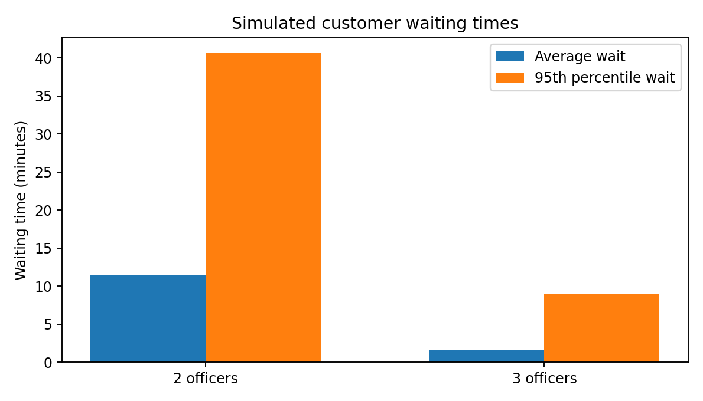
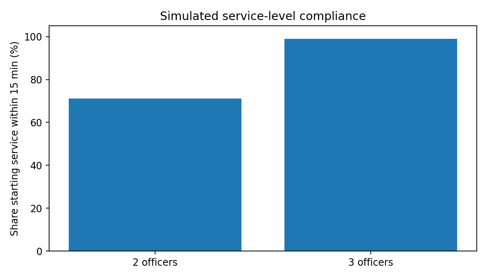

# Retail Banking Service Centre — Capacity Simulation

An independent **Python extension** of my September 2026 Operations Analytics assignment. It explores a simple staffing question: how much do customer waiting times improve if a synthetic banking service centre uses **three officers instead of two**, and what does that extra capacity cost?

> **Academic context:** My original work was a written simulation-based capacity-planning report. I subsequently implemented this runnable Python model as a separate portfolio extension. The figures below come from **this implementation**, not directly from the report. This is a synthetic scenario, not data from a real bank.

## The scenario

- Customers arrive at an average rate of **8.5 per hour**, with exponential inter-arrival times.
- Service times are **lognormal**, with a **12-minute mean** and **0.25 coefficient of variation**.
- Opening hours: **six hours per day**, across **30 operating days** per replication.
- Compare a **2-officer** and **3-officer** single-queue, first-come-first-served setup.
- **30 replications**; the same generated daily arrivals and customer service requirements are used for both staffing scenarios within each replication.
- Target: customers **start service within 15 minutes**. Direct labour cost: **LKR 2,000 per officer-hour**.

The model admits customers during the six-hour window and finishes serving admitted customers after closing if necessary. Each day's queue resets the following morning. Utilisation is busy time **within opening hours** divided by scheduled officer minutes; overtime is not priced separately.

## Results from the Python model

| Metric (averaged across 30 replications) | 2 officers | 3 officers |
| --- | ---: | ---: |
| Customers arriving over 30 days | 1,524.6 | 1,524.6 |
| Average waiting time | 11.47 min | 1.55 min |
| 95th-percentile waiting time | 40.66 min | 8.95 min |
| Average time in system | 23.46 min | 13.54 min |
| Customers starting service within 15 min | 71.06% | 98.92% |
| Utilisation during opening hours | 79.84% | 55.18% |
| Scheduled labour cost | LKR 720,000 | LKR 1,080,000 |

These are seeded simulation estimates, not measured bank performance. They may differ from the figures in the original report due to implementation choices and random sampling. In particular, customer arrivals stop at closing, but service continues until the last customer is finished.

## What I learned

Average demand alone doesn't tell us whether a customer-service operation will deliver good waiting times. An extra officer adds a buffer against unpredictable arrivals and long services, but increases scheduled staffing cost by **50%**. The model helps compare the trade-off; it does not prescribe staffing for a real bank.

## Files

- [`analysis/capacity_simulation.ipynb`](analysis/capacity_simulation.ipynb) — an annotated Jupyter Notebook with the model and results.
- [`analysis/simulation.py`](analysis/simulation.py) — the runnable simulation script.
- `visuals/` — two charts created by the simulation.
- [`requirements.txt`](requirements.txt) — required Python libraries.

## How to run

1. Download the repository or clone it.
2. Install dependencies: `pip install -r requirements.txt`
3. Run `python analysis/simulation.py` or open `analysis/capacity_simulation.ipynb` in Jupyter.

A fixed random seed makes runs reproducible with the same library versions. No external bank dataset is required.

## Limitations

This is a simplified synthetic model: a constant average arrival rate, one service category, a common queue, no breaks or customer abandonment, and no accommodation for shifts, overhead or overtime costs. Real capacity planning would require validated arrival patterns, service-time records, and actual operating costs. The original report's numerical results are **not treated as a validation target** for this independently developed model.
